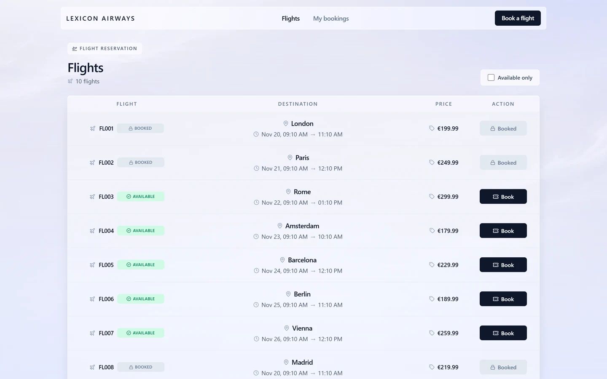
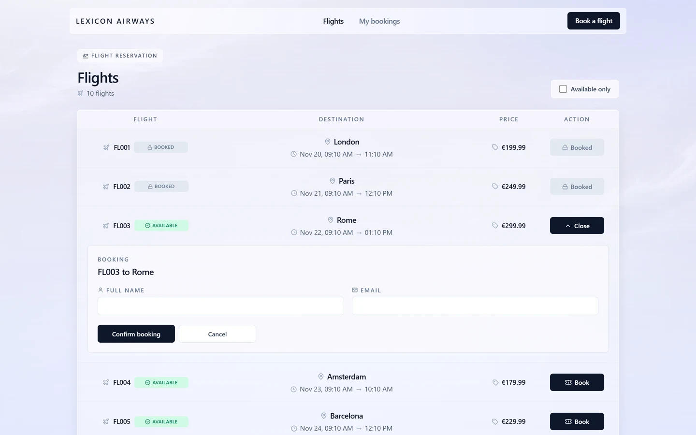
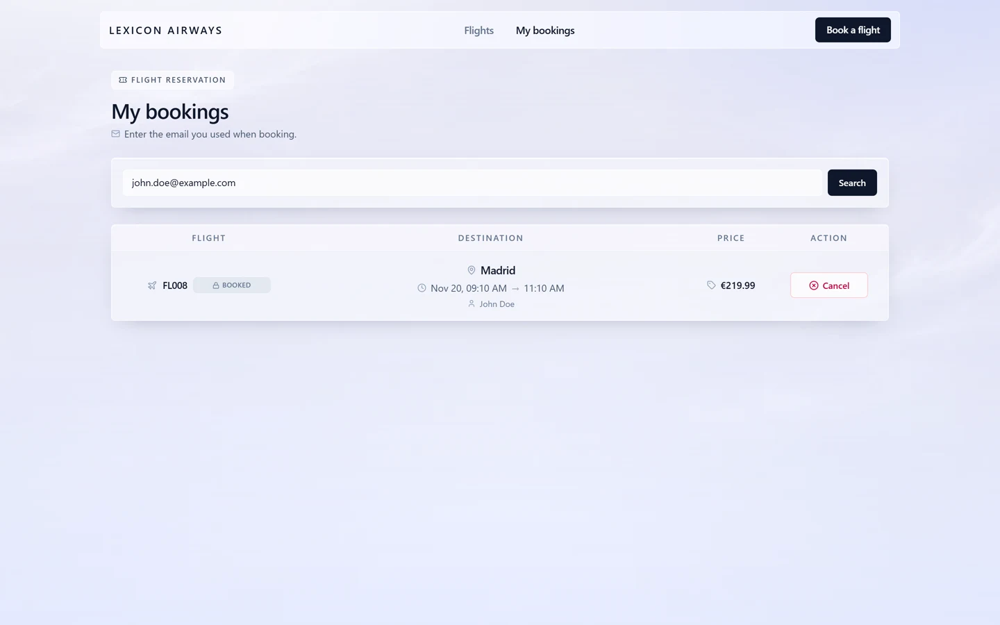

# Flight Reservation UI

A React and TypeScript frontend for a provided Spring Boot flight booking API.

Users can browse flights, book one with a name and email, look up their bookings by email, and cancel a booking.



---

## Contents

- [Features](#features)
- [Screens](#screens)
- [Tech stack](#tech-stack)
- [Architecture](#architecture)
- [Getting started](#getting-started)
- [API](#api)
- [Implementation notes](#implementation-notes)
- [Design](#design)
- [Known limitations](#known-limitations)
- [Git workflow](#git-workflow)
- [What I would do next](#what-i-would-do-next)

---

## Features

| Feature | Notes |
|---|---|
| View all flights | One row per flight: flight number, status, destination, times, price |
| View available flights only | URL-driven filter, `?available=true` |
| Book a flight | Inline form, opens under the selected row |
| Look up bookings by email | Server-side filter by passenger email |
| Cancel a booking | Same row, with a pending state |
| Responsive navigation | Inline links above 768px, a glass menu below |

## Screens

| Booking form | My bookings |
|---|---|
|  |  |

---

## Tech stack

| Layer | Tool |
|---|---|
| UI | React 19 |
| Language | TypeScript |
| Build | Vite 8 |
| Routing | React Router 7 |
| Styling | Tailwind CSS v4 |
| Icons | `lucide-react` |
| Lint | oxlint |
| API | Spring Boot 4, Java 25, MySQL |

---

## Architecture

```
frontend/src/
├── api/
│   ├── client.ts        fetch wrapper, error parsing
│   ├── flights.ts       one function per endpoint
│   └── types.ts         mirrors the backend DTOs
├── components/
│   ├── BookingForm.tsx  form with client-side validation
│   ├── FlightListHeader.tsx  column labels for the list
│   ├── FlightRow.tsx    one row: flight, route, price, action slot
│   ├── Navbar.tsx       floating glass bar, mobile menu
│   └── Toast.tsx        bottom toast, rendered in a portal
├── lib/
│   ├── cache.ts         in-memory list cache
│   └── format.ts        date, time, EUR price
└── pages/
    ├── FlightsPage.tsx
    └── BookingsPage.tsx
```

Rules the code follows:

- `api/` owns HTTP. Components receive props only.
- All state is local. No global store.
- No UI library. The brief asks for hooks, so the UI is built from hooks.
- A component is extracted when it is reused, or when a block carries its own state. Pages stay long because they compose; they do not render.

### Data flow

```
route → page → api/ → fetch → client.ts
                    ↓
                JSON or ProblemDetail
                    ↓
          page state → components
```

---

## Getting started

### Prerequisites

- Node.js 20.19 or newer
- JDK 25
- MySQL on `localhost:3306`

### 1. Backend

```bash
cd backend
./mvnw spring-boot:run
```

Windows:

```powershell
cd backend
.\mvnw.cmd spring-boot:run
```

The API runs on `http://localhost:8080`. Swagger UI: `http://localhost:8080/swagger-ui.html`.

The seed runner inserts 10 flights once, then skips while the table is not empty.

### 2. Frontend

```bash
cd frontend
npm install
npm run dev
```

The app runs on `http://localhost:5173`. The backend CORS config allows this port.

### Environment

```bash
cd frontend
cp .env.example .env
```

| Variable | Default |
|---|---|
| `VITE_API_BASE_URL` | `http://localhost:8080` |

### Scripts

| Command | Action |
|---|---|
| `npm run dev` | Dev server |
| `npm run build` | Type-check and production build |
| `npm run preview` | Preview the build |
| `npm run lint` | oxlint |

---

## API

Base URL: `http://localhost:8080`

| Method | Path | Body | Success |
|---|---|---|---|
| GET | `/api/flights` | – | 200 `FlightListDTO[]` |
| GET | `/api/flights/available` | – | 200 `AvailableFlightDTO[]` |
| POST | `/api/flights/{flightId}/book` | `{ passengerName, passengerEmail }` | 200 `FlightBookingDTO` |
| GET | `/api/flights/bookings?email=` | – | 200 `FlightBookingDTO[]` |
| DELETE | `/api/flights/{flightId}/cancel?email=` | – | 204, empty body |

### Contract notes

- `DELETE` returns **204 with no body**. The client never parses it.
- Errors use RFC 9457 `ProblemDetail`. The UI shows the `detail` field.
- Dates are local ISO strings, for example `2026-11-20T09:10:00`. No timezone.
- `GET /api/flights` includes `status`. `GET /api/flights/available` does not.
- The API sends `price` with no currency. The UI formats it as EUR.

---

## Implementation notes

These are the decisions worth explaining in a review.

| Problem | Approach |
|---|---|
| Filter must survive a refresh and be shareable | The filter is a URL parameter, not component state. The checkbox reads and writes `?available=true`. |
| Navigating between pages flashed a loading bar | The last list is kept in a module-level cache and painted on remount, then revalidated. The refresh only dims the list if it takes longer than 150 ms. |
| The booking form snapped open and closed | The form stays mounted. The wrapper animates `grid-template-rows` from `0fr` to `1fr`, so both directions animate to the content height without hardcoded values. |
| A hidden form stayed in the tab order | `inert` on the collapsed wrapper. It removes the subtree from the accessibility tree and blocks focus. |
| The toast appeared mid-page | The route wrapper animates with a transform, which captures `fixed` children. The toast renders into `document.body` with a portal. |
| Duplicate seed rows on every restart | The provided runner now checks `count() > 0` before inserting. |
| Slow or failed request leaves a stale screen | An error never replaces a list that is already on screen. A banner appears above the current data, and the next visit refetches. |

---

## Design

The interface is a booking tool, not a marketing page. The price and status are visible without a click, and each row has one primary action.

### Tokens

| Token | Value |
|---|---|
| Background | Sky photo with two radial highlights and an indigo wash |
| Surface | `white/40` to `white/75`, `backdrop-blur-2xl` |
| Navbar | `white/55`, `backdrop-blur-xl`, `backdrop-saturate-150` |
| Text | `slate-900` |
| Muted text | `slate-500` and `slate-600` |
| Primary | `slate-900` |
| Success | `emerald-100` fill, `emerald-700` text |
| Danger | `rose-50` fill, `rose-200` border, `rose-700` text |
| Radius | `rounded-md` on every element |
| Type scale | 11px label, 13–15px UI, `text-3xl` heading |
| Font | System sans, no download |

### Accessibility

- Every form field has a label. Labels are linked with `useId`.
- The mobile menu button exposes `aria-expanded` and `aria-controls`.
- The toast uses `role="status"` and `aria-live="polite"`.
- Decorative icons are `aria-hidden`.
- Hidden content uses `inert`, never a focusable tree under `aria-hidden`.

---

## Known limitations

- One passenger per flight. There is no seat inventory.
- Email is the only identity. No authentication.
- The API sends no currency. EUR is a display decision on the frontend.
- Requests are not cancelled with an `AbortController` yet. A fast filter toggle can let an older response arrive last.
- The frontend does not add airports, sorting, or payments. The API has no data for them.

---

## Git workflow

- `main` holds working code. One branch per feature, merged with `--no-ff`.
- Small commits in the form `type(scope): summary`.

| Prefix | Use |
|---|---|
| `feat` | New behaviour |
| `fix` | Repair a defect |
| `style` | Presentation only |
| `refactor` | Structure change, same behaviour |
| `docs` | Documentation |
| `chore` | Setup and tooling |

`npm run build` and `npm run lint` must pass before a merge.

---

## What I would do next

1. Add `AbortController` to the fetch layer, to close the stale-response race.
2. Move the flight cache into a small query hook with a stale time.
3. Add a booking route with a deep link, so a booking page can be shared.
4. Add component tests for the API layer's error parsing.

---

Built as part of the Lexicon ReactJS course.
